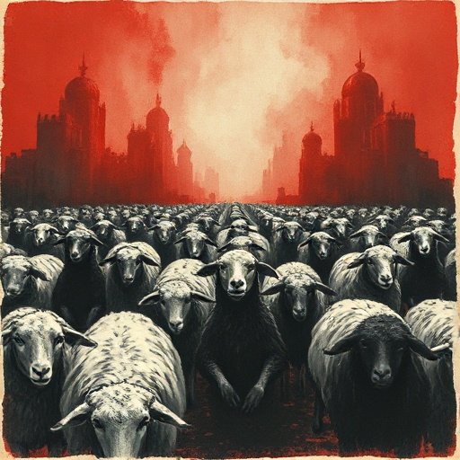

## Allegorie

Eine Geschichte, in der Figuren, Orte und Ereignisse systematisch für Ideen, Zustände oder reale Situationen stehen, die eine zweite Bedeutungsebene erzeugen.

### Funktion

Ermöglicht Gesellschaftskritik und moralische Aussagen in fiktionalem Gewand, das direkte Kritik umgeht.

### Anwendung

Auf welche reale Situation oder Ideologie spiegelt meine Geschichte – und welche Elemente der Allegorie sind für den Leser lesbar, welche versteckt?

### Beispiele

- Animal Farm (Orwell – Sowjetunion)
- Herr der Fliegen (Golding – Zivilisation vs. Barbarei)

### Vorsicht

Zu direkte Allegorie reduziert Figuren zu Symbolen ohne eigene Lebendigkeit.

### Passt zu

- [Symbol](symbol.md)
- [Moralische Prämisse](moralische-praemisse.md)

### Bild

