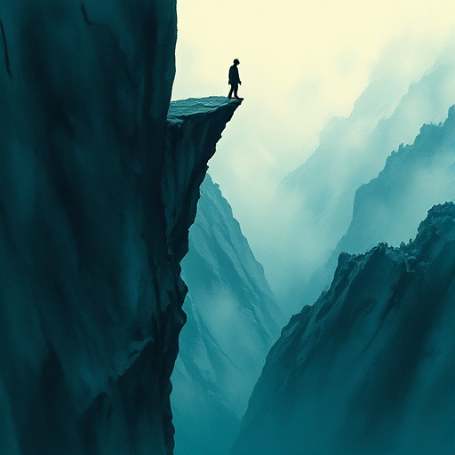

## Cliffhanger

Ein Kapitel oder eine Szene endet an einem Punkt maximaler Spannung, kurz vor der Auflösung eines Konflikts.

### Funktion

Erzeugt zwingenden Lesedrang über Kapitelgrenzen hinaus und lässt das Buch schwer weglegbar erscheinen.

### Anwendung

Was ist die schlimmste oder interessanteste mögliche Situation, in der ich meine Figur an einer Kapitelgrenze zurücklassen kann?

### Beispiele

- Dickens' Serienromane
- Fast jede Folge von Game of Thrones
- Dan Brown (The Da Vinci Code)

### Vorsicht

Zu viele Cliffhanger ohne Auflösung erzeugen Leser-Frustration statt Spannung.

### Passt zu

- [Zeitdruck](zeitdruck.md)
- [Wendepunkt der Szene](wendepunkt-der-szene.md)

### Bild

