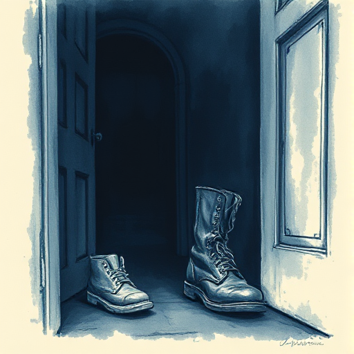

## Coming of Age

Eine meist junge Figur wächst durch prägende Erfahrungen aus der Kindheit oder Adoleszenz in die Erwachsenenwelt hinein und verliert dabei eine Form der Unschuld.

### Funktion

Bindet den Leser über vertraute Erfahrungen wie Verlust, Identitätssuche und ersten Schmerz stark an die Figur.

### Anwendung

Welche spezifische Illusion oder welchen Schutz verliert meine Figur in dieser Geschichte? Wann genau passiert das?

### Beispiele

- Holden Caulfield (The Catcher in the Rye)
- Scout Finch (To Kill a Mockingbird)
- Bastian (Die unendliche Geschichte)

### Warnung

Coming of Age ohne echten Verlust oder Schmerz ist sentimental statt bewegend.

### Passt zu

- [Positiver Wandlungsbogen](positiver-wandlungsbogen.md)
- [Wunsch vs. Bedürfnis](wunsch-vs-beduerfnis.md)
- [Die Unschuldige](die-unschuldige.md)

### Bild

