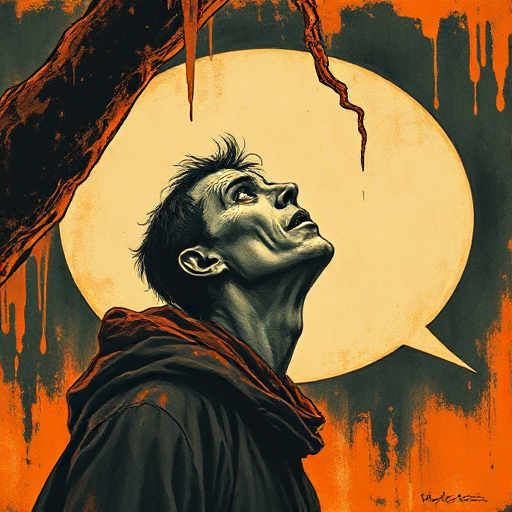

## Das Ungesagte

Das bedeutendste Gesprächselement ist manchmal das, was nicht gesagt wird: die Pause, das Schweigen, das Ausweichen.

### Funktion

Gibt dem Leser eine aktive Interpretationsaufgabe und erzeugt Spannung durch das Bewusstsein, dass etwas Wichtiges zurückgehalten wird.

### Anwendung

Welche Aussage in meinem Dialog kann ich in Schweigen oder Themenwechsel verwandeln? Ist das Ungesagte für den Leser trotzdem verständlich?

### Beispiele

- Der Vorleser (Schlink)
- Pinter-Pausen in Bühnenstücken
- Hemingways Kurzprosa allgemein

### Passt zu

- [Subtext](subtext.md)
- [Figur vs. sich selbst](figur-vs-sich-selbst.md)

### Bild

