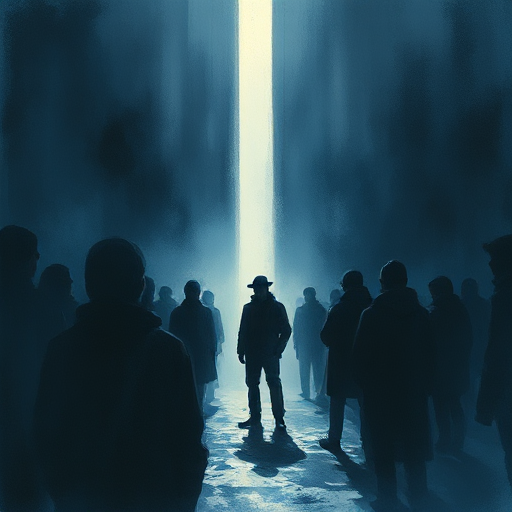

## Der Auserwählte

Eine Figur, die durch Schicksal, Prophezeiung oder besondere Herkunft eine entscheidende Aufgabe zugesprochen bekommt. Sie ist dazu bestimmt, das Ungleichgewicht der Welt zu heilen.

### Funktion

Verleiht dem Protagonisten eine kosmische Bedeutung und erzeugt Spannung durch die Frage: Wird er seiner Bestimmung gerecht – oder scheitert er?

### Anwendung

Wie subvertiert meine Geschichte die Erwartung des Auserwählten – durch Fehlbarkeit, Zweifel oder eine falsche Prophezeiung?

### Beispiele

- Harry Potter
- Neo (Matrix)
- Anakin Skywalker (Star Wars)

### Vorsicht

Ohne Zweifel und Versagen wirkt der Auserwählte wie ein unfehlbarer Gott statt wie eine menschliche Figur.

### Passt zu

- [Die Prophezeiung](die-prophezeiung.md)
- [Positiver Wandlungsbogen](positiver-wandlungsbogen.md)

### Bild

