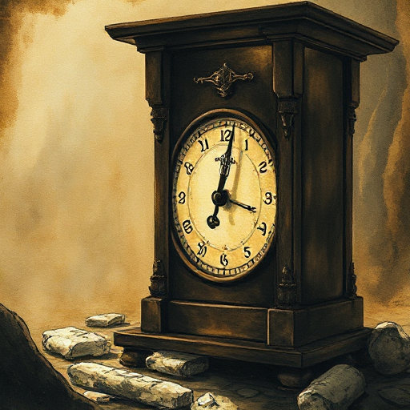

## Der Beat

Die kleinste dramatische Einheit: ein einzelner Austausch von Aktion und Reaktion zwischen Figuren oder innerhalb einer Figur, der eine minimale Veränderung bewirkt.

### Funktion

Beats sind die Atome des Dramas; eine Szene ist eine Folge von Beats. Wer Beats bewusst gestaltet, kontrolliert das Pacing auf Mikroebene.

### Anwendung

Verlangsame eine Szene, indem du mehr Beats einfügst; beschleunige sie, indem du Beats zusammenfasst oder weglässt.

### Beispiele

- Schnelle Dialoge in Screwball-Komödien vs. schweigende Gegenüberstellungen in psychologischen Dramen

### Passt zu

- [Wendepunkt der Szene](wendepunkt-der-szene.md)
- [Prosa-Rhythmus](prosa-rhythmus.md)

### Quellen

- Story, Robert McKee

### Bild

