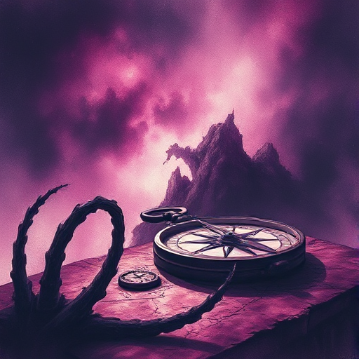

## Der Entdecker

Eine Figur, die von Neugier, Freiheitsdrang und dem Wunsch angetrieben wird, das Unbekannte zu erforschen. Sie flieht vor Enge und sucht ständig neue Horizonte.

### Funktion

Treibt Abenteuerhandlungen an, lässt die Welt beiläufig sichtbar werden und trägt das Thema Freiheit vs. Verantwortung.

### Anwendung

Was entdeckt meine Figur auf ihrer Reise, das sie verändert? Was hätte sie lieber nicht gewusst?

### Beispiele

- Indiana Jones
- Bilbo Baggins (The Hobbit)
- Lyra Silvertongue (His Dark Materials)
- Captain Ahab (Moby Dick) als dunkle Variante

### Warnung

Ein Entdecker ohne innere Entwicklung ist nur eine Plotmaschine. Das Entdeckte muss ihn verwandeln.

### Passt zu

- [Die Heldenreise](die-heldenreise.md)
- [Fish out of Water](fish-out-of-water.md)

### Quellen

- The Hero and the Outlaw, Margaret Mark & Carol S. Pearson

### Bild

