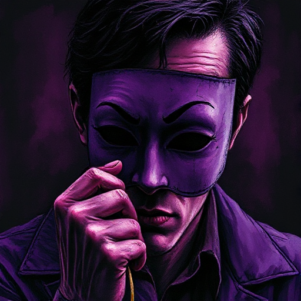

## Der Gestaltwandler

Eine Figur, deren Absichten und Loyalitäten für den Helden und den Leser schwer zu durchschauen sind. Sie schwankt zwischen Vertrauen und Bedrohung.

### Funktion

Erzeugt Unsicherheit und Spannung, lässt bis zuletzt offen, ob die Figur Verbündeter oder Verräter ist, und ermöglicht überraschende Wendungen.

### Anwendung

An welchem Punkt der Geschichte offenbart mein Gestaltwandler, auf welcher Seite er wirklich steht? Wie bereite ich das durch frühere Szenen vor?

### Beispiele

- Hans (Frozen)
- Severus Snape (Harry Potter)
- Amy Dunne (Gone Girl)

### Vorsicht

Zu viele Gesinnungswechsel ohne innere Logik wirken beliebig statt spannend.

### Passt zu

- [Falsche Fährte (Red Herring)](falsche-faehrte.md)
- [Der Twist](der-twist.md)
- [Geheime Identität](geheime-identitaet.md)

### Quellen

- Die Odyssee des Drehbuchschreibers, Christopher Vogler

### Bild

