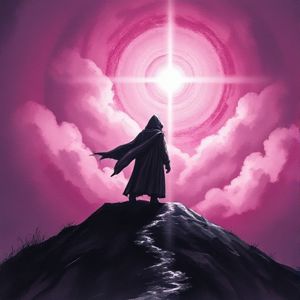

## Der Held

Die Figur im Zentrum der Geschichte, die im Lauf der Ereignisse eine innere Wandlung durchläuft. Er verkörpert das Streben des Lesers nach Bedeutung und Selbstüberwindung.

### Funktion

Gibt dem Leser eine Figur zum Mitfühlen und treibt die Handlung durch aktive Entscheidungen voran. Seine Schwächen erzeugen den Konflikt, seine Entwicklung die emotionale Belohnung.

### Anwendung

Was will meine Figur bewusst – und was braucht sie wirklich? Wo weichen diese beiden Dinge voneinander ab?

### Beispiele

- Frodo Beutlin (Der Herr der Ringe)
- Luke Skywalker (Star Wars)
- Katniss Everdeen (Die Tribute von Panem)

### Vorsicht

Ein Held ohne echte Fehler oder Schwächen bleibt unnahbar; der Leser investiert emotional nicht in ihn.

### Passt zu

- [Die Wunde](die-wunde.md)
- [Wunsch vs. Bedürfnis](wunsch-vs-beduerfnis.md)

### Quellen

- Der Heros in tausend Gestalten, Joseph Campbell
- Die Odyssee des Drehbuchschreibers, Christopher Vogler

### Bild

