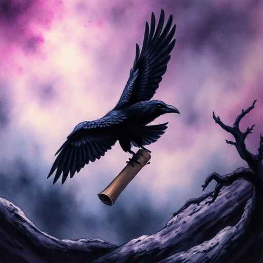

## Der Herold

Eine Figur oder ein Ereignis, das den Ruf zum Abenteuer überbringt und Wandel ankündigt. Er markiert den Beginn einer neuen Phase.

### Funktion

Setzt die Handlung in Gang und macht dem Protagonisten und dem Leser klar, dass die gewohnte Welt sich verändert hat oder verändern wird.

### Anwendung

Wie kündigt sich der erste Bruch in der Alltagswelt meiner Figur an? Durch eine Begegnung, eine Nachricht oder ein ungewöhnliches Ereignis?

### Beispiele

- Der Brief von Hogwarts (Harry Potter)
- R2-D2 mit Leias Botschaft (Star Wars)

### Passt zu

- [Die Heldenreise](die-heldenreise.md)
- [In Medias Res](in-medias-res.md)

### Quellen

- Die Odyssee des Drehbuchschreibers, Christopher Vogler

### Bild

