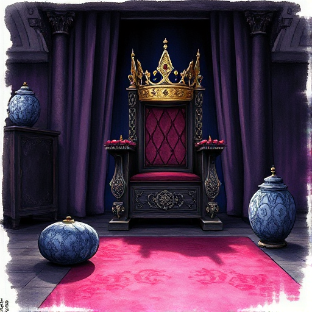

## Der Herrscher

Eine Figur, die Macht, Kontrolle und Ordnung verkörpert. Sie definiert die Regeln der Welt und kämpft darum, Autorität und Status zu erhalten.

### Funktion

Verkörpert die Macht der Institutionen, steckt den Rahmen des Konflikts ab und kann schützend wie tyrannisch wirken.

### Anwendung

Welche Ordnung verteidigt mein Herrscher – und welche Kosten zahlen jene, die unter ihr leben?

### Beispiele

- Tywin Lannister (Game of Thrones)
- Don Corleone (Der Pate)
- König Mufasa (Der König der Löwen)
- Miranda Priestly (Der Teufel trägt Prada)

### Vorsicht

Ein Herrscher ohne persönliche Motivation und innere Logik wird zum flachen Antagonisten.

### Passt zu

- [Figur vs. Gesellschaft](figur-vs-gesellschaft.md)
- [Ökonomie & Macht](oekonomie-macht.md)

### Quellen

- The Hero and the Outlaw, Margaret Mark & Carol S. Pearson

### Bild

