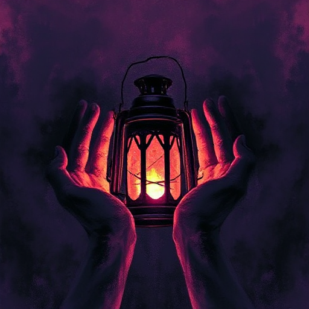

## Der Mentor

Eine erfahrene Figur, die dem Helden Wissen, Werkzeuge oder Motivation mitgibt. Er verkörpert die höhere Weisheit, die der Held noch erwerben muss.

### Funktion

Ermöglicht glaubwürdige Exposition ohne Info-Dump, stellt Ausrüstung oder Aufgaben bereit und erhöht die Einsätze durch seinen späteren Tod oder Rückzug.

### Anwendung

Welche entscheidende Lektion gibt mein Mentor dem Helden mit? Wann wird dieser sie erstmals missverstehen?

### Beispiele

- Gandalf (The Lord of the Rings)
- Obi-Wan Kenobi (Star Wars)
- Dumbledore (Harry Potter)
- Haymitch (The Hunger Games)

### Warnung

Ein Mentor, der zu viel löst, nimmt dem Helden die Handlungsmacht.

### Passt zu

- [Der Mentorentod](der-mentorentod.md)
- [Der Held](der-held.md)
- [Der Weise](der-weise.md)

### Quellen

- Die Odyssee des Drehbuchschreibers, Christopher Vogler

### Bild

