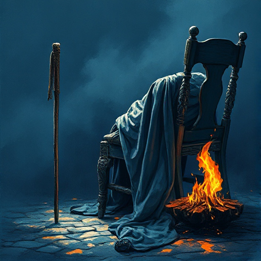

## Der Mentorentod

Der Mentor des Helden stirbt oder verlässt die Geschichte in einem wichtigen Moment, um den Helden zu zwingen, auf eigene Kräfte zu vertrauen.

### Funktion

Markiert den Übergang vom Lernenden zum Handelnden, erhöht die emotionalen Einsätze und gibt dem Helden einen persönlichen Verlust als Motivation.

### Anwendung

Welchen Tod oder Abgang muss mein Held verkraften, bevor er die letzte Prüfung allein bestehen kann?

### Beispiele

- Obi-Wan Kenobi (Star Wars)
- Gandalf an der Brücke von Khazad-dûm
- Mufasa (The Lion King)
- Dumbledore (Harry Potter)

### Vorsicht

Der Tod des Mentors wirkt billig, wenn er kein Echo in der weiteren Handlung hat.

### Passt zu

- [Der Mentor](der-mentor.md)
- [Midpoint-Reversal](midpoint-reversal.md)

### Bild

