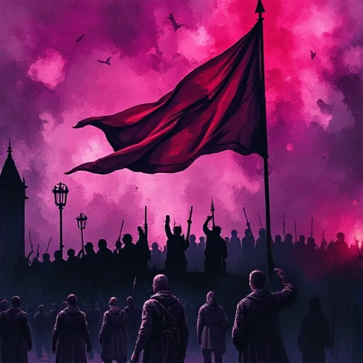

## Der Rebell

Eine Figur, die sich gegen etablierte Normen, Autoritäten oder Systeme auflehnt. Er verkörpert den Wunsch nach Autonomie und Wandel.

### Funktion

Treibt gesellschaftliche Konflikte voran, bringt die Außenseiter-Perspektive ein und kann den Umbruch des Bestehenden auslösen.

### Anwendung

Gegen welches konkrete System oder welche Norm rebelliert meine Figur? Was kostet sie dieser Widerstand?

### Beispiele

- Katniss Everdeen (The Hunger Games)
- McMurphy (One Flew Over the Cuckoo's Nest)
- V (V for Vendetta)

### Warnung

Rebellion ohne persönliche Konsequenz erzeugt keine echte Spannung.

### Passt zu

- [Figur vs. Gesellschaft](figur-vs-gesellschaft.md)
- [Negativer Bogen](negativer-bogen.md)

### Quellen

- The Hero and the Outlaw, Margaret Mark & Carol S. Pearson

### Bild

