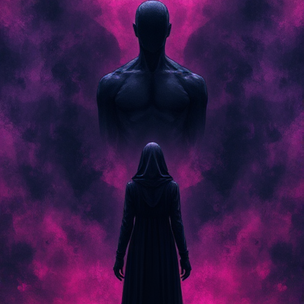

## Der Schatten

Der Antagonist oder die dunklere innere Kraft, die dem Helden gegenübersteht. Er spiegelt oft die unerfüllten Potenziale oder verdrängten Impulse des Helden.

### Funktion

Erzeugt den zentralen Konflikt und zwingt den Helden zur Konfrontation mit seiner eigenen Dunkelheit. Je ähnlicher Schatten und Held, desto stärker die Spannung.

### Anwendung

Welche Eigenschaft des Antagonisten könnte auch in meinem Helden stecken? Unter welchen Umständen hätte der Held denselben Weg gewählt?

### Beispiele

- Voldemort (Harry Potter)
- Hannibal Lecter (The Silence of the Lambs)
- Thanos (Avengers: Infinity War)

### Warnung

Ein Schatten, der nur böse ist ohne Motivation, erzeugt keine echte thematische Spannung.

### Passt zu

- [Figur vs. sich selbst](figur-vs-sich-selbst.md)
- [Gegen-Thema](gegen-thema.md)

### Quellen

- Die Archetypen und das kollektive Unbewusste, C.G. Jung
- Die Odyssee des Drehbuchschreibers, Christopher Vogler

### Bild

