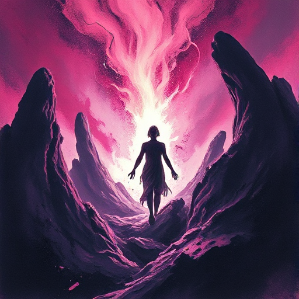

## Der Schöpfer

Eine Figur, die durch Erschaffen und die Realisierung von Visionen angetrieben wird. Sie will Bleibendes schaffen und kämpft gegen Grenzen und Mittelmaß.

### Funktion

Trägt das Thema von Schöpfung, Kontrolle und Verantwortung für das Geschaffene. Stellt die Frage, ob der Schöpfer auch über sein Werk herrscht.

### Anwendung

Was erschafft meine Figur? Welche unbeabsichtigten Konsequenzen bringt das Geschaffene mit sich?

### Beispiele

- Victor Frankenstein (Shelley)
- Tony Stark als Erfinder (Iron Man)
- Willy Wonka (Charlie and the Chocolate Factory)
- Dr. Hammond (Jurassic Park)

### Warnung

Der Schöpfer neigt zur Selbstüberschätzung. Ohne persönlichen Preis für unkontrollierte Kreativität fehlt die dramatische Tiefe.

### Passt zu

- [Figur vs. Technologie](figur-vs-technologie.md)
- [Tragischer Fehler](tragischer-fehler.md)

### Quellen

- The Hero and the Outlaw, Margaret Mark & Carol S. Pearson

### Bild

