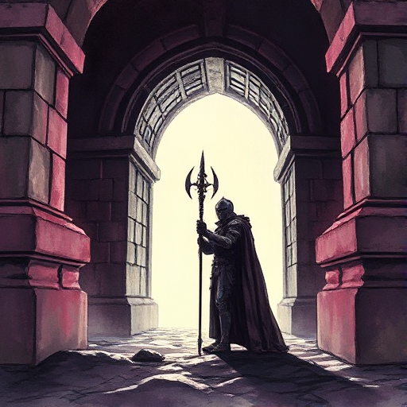

## Der Schwellenhüter

Eine Figur oder Kraft, die den Zugang zu einer neuen Welt, Stufe oder Information bewacht. Sie testet die Bereitschaft des Helden.

### Funktion

Markiert narrative Übergänge, erhöht die Einsätze vor Schlüsselmomenten und zeigt dem Leser, dass der Held sich bewähren muss.

### Anwendung

Was bewacht die nächste Schwelle meiner Hauptfigur? Ist es eine Figur, eine Prüfung oder eine innere Hemmung?

### Beispiele

- Die Agents in The Matrix
- Cerberus (Griechische Mythologie)
- Gollum am Eingang zu Mordor

### Passt zu

- [Die Heldenreise](die-heldenreise.md)
- [Szenenziel & Hindernisse](szenenziel-hindernisse.md)

### Quellen

- Die Odyssee des Drehbuchschreibers, Christopher Vogler

### Bild

