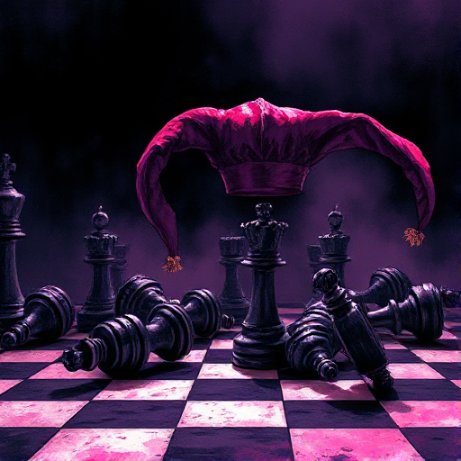

## Der Trickster

Eine Figur, die durch Humor, List und regelwidriges Denken Konventionen bricht. Er steht außerhalb der sozialen Ordnung und hinterfragt sie.

### Funktion

Schafft Komödienmomente, löst Spannungsknoten durch Überraschung und spiegelt absurde oder ungerechte Systeme satirisch wider.

### Anwendung

Welche ernste Situation in meiner Geschichte könnte durch die unerwartete Intervention eines Tricksters gebrochen und neu beleuchtet werden?

### Beispiele

- Loki (Nordische Mythologie / Marvel)
- Jack Sparrow (Pirates of the Caribbean)
- Fred & George Weasley (Harry Potter)

### Vorsicht

Ein Trickster, der nie Konsequenzen trägt, verliert seine dramatische Glaubwürdigkeit.

### Passt zu

- [Ruhepause](ruhepause.md)
- [Der Verbündete](der-verbuendete.md)

### Quellen

- Die Archetypen und das kollektive Unbewusste, C.G. Jung
- Die Odyssee des Drehbuchschreibers, Christopher Vogler

### Bild

