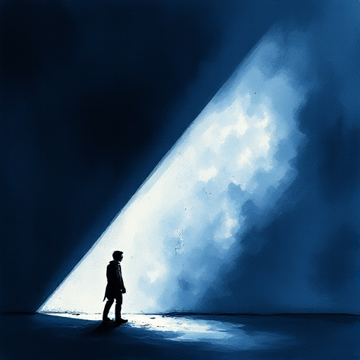

## Der Underdog

Eine Figur oder Gruppe, die gegen übermächtige Gegner, Umstände oder Systeme kämpft und von niemandem erwartet wird zu gewinnen.

### Funktion

Aktiviert universelle Empathie, da der Leser naturgemäß für die Schwächeren Partei ergreift.

### Anwendung

Welche konkrete Fähigkeit oder Eigenschaft gibt meinem Underdog eine echte, wenn auch unwahrscheinliche Chance?

### Beispiele

- Rocky Balboa (Rocky)
- Rudy Ruettiger (Rudy)
- Katniss (Die Tribute von Panem)

### Vorsicht

Ein Underdog, der ohne Vorbereitung oder Entwicklung gewinnt, enttäuscht; der Sieg muss verdient sein.

### Passt zu

- [Figur vs. Gesellschaft](figur-vs-gesellschaft.md)
- [Positiver Wandlungsbogen](positiver-wandlungsbogen.md)

### Bild

