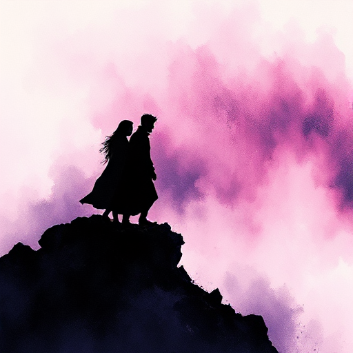

## Der Verbündete

Eine Figur, die den Helden auf seiner Reise begleitet, unterstützt und durch ihren eigenen Charakter bereichert.

### Funktion

Ermöglicht Dialog als Spiegel für die Gedanken des Helden, verteilt emotionale Last und kann als Kontrast zur Hauptfigur dienen.

### Anwendung

Was bringt mein Verbündeter ein, das mein Held allein nicht hätte? Wo könnten ihre Ziele in Konflikt geraten?

### Beispiele

- Hermione & Ron (Harry Potter)
- Chewbacca (Star Wars)
- Dr. Watson (Sherlock Holmes)

### Vorsicht

Ein Verbündeter ohne eigene Wünsche und Fehler ist nur ein Werkzeug, keine Figur.

### Passt zu

- [Kontrastfigur (Foil)](kontrastfigur.md)
- [Flacher Bogen](flacher-bogen.md)
- [Die Fürsorgerin](die-fuersorgerin.md)

### Quellen

- Die Odyssee des Drehbuchschreibers, Christopher Vogler

### Bild

