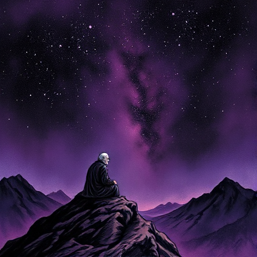

## Der Weise

Eine Figur, die durch lange Beobachtung tiefes Verständnis von Wahrheit und Bedeutung erlangt hat. Im Gegensatz zum Mentor sucht er nicht aktiv Schüler, sondern verkörpert Erkenntnis.

### Funktion

Verankert das Thema der Geschichte und liefert Perspektive auf die Handlung, ohne direkt einzugreifen. Sein Wissen relativiert die unmittelbaren Konflikte.

### Anwendung

Was weiß meine Weisheitsfigur, das der Held erst am Ende verstehen wird? Wie deutet sie es an, ohne es zu verraten?

### Beispiele

- Yoda (Star Wars)
- Oogway (Kung Fu Panda)
- Rafiki (The Lion King)
- der alte Fischer in The Old Man and the Sea (Hemingway)

### Warnung

Ein Weiser, der alle Antworten ausspricht, ersetzt die Reise des Helden durch eine Lektion.

### Passt zu

- [Der Mentor](der-mentor.md)
- [Thematische Frage](thematische-frage.md)

### Quellen

- Die Archetypen und das kollektive Unbewusste, C.G. Jung
- The Hero and the Outlaw, Margaret Mark & Carol S. Pearson

### Bild

