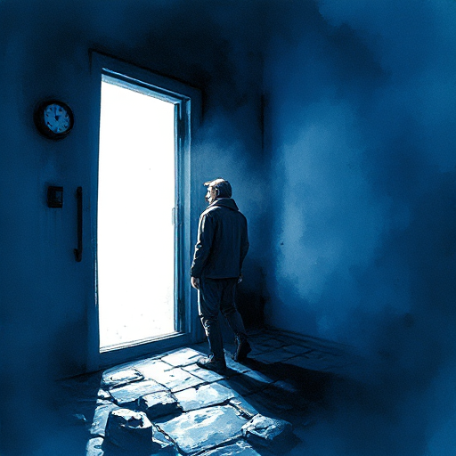

## Der widerwillige Held

Ein Protagonist, der seine Aufgabe zunächst ablehnt und erst durch äußere Umstände oder Verlust in die Handlung gezwungen wird.

### Funktion

Macht den Helden menschlicher und nachvollziehbarer. Die Weigerung macht die spätere Entscheidung zur Handlung bedeutungsvoller.

### Anwendung

Was ist der genaue Moment und der präzise Grund, warum meine Figur nicht mehr nein sagen kann?

### Beispiele

- Bilbo Baggins (The Hobbit)
- Neo (The Matrix)
- Rick Blaine (Casablanca)

### Warnung

Der Held darf die Weigerung nicht zu lange aufrechterhalten, sonst verliert er Sympathie.

### Passt zu

- [Die Heldenreise](die-heldenreise.md)
- [Wunsch vs. Bedürfnis](wunsch-vs-beduerfnis.md)

### Bild

