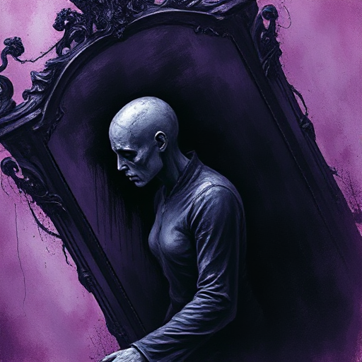

## Die Lüge der Figur

Eine falsche Überzeugung über sich selbst, andere oder die Welt, die die Figur als Wahrheit behandelt und die ihr Handeln in selbstschädigender Weise steuert.

### Funktion

Ist der Motor des inneren Charakterbogens. Die Geschichte deckt Schicht für Schicht auf, warum diese Überzeugung falsch ist, bis die Figur sie aufgeben kann oder muss.

### Anwendung

Formuliere die Lüge deiner Figur als konkreten Satz – und wie formt sie jede ihrer Entscheidungen?

### Beispiele

- »Keine echte Verbindung ist möglich« (Her)
- »Schwäche ist Schande« (Thor – Marvel)
- traumatisierte Überlebende in nahezu allen Psychodramen

### Passt zu

- [Wunsch vs. Bedürfnis](wunsch-vs-beduerfnis.md)
- [Die Wunde](die-wunde.md)

### Quellen

- Creating Character Arcs, K.M. Weiland

### Bild

