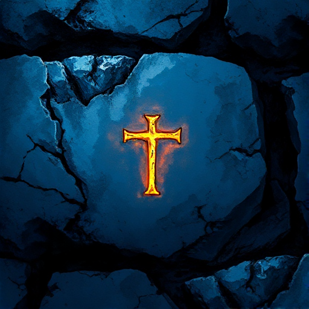

## Die Prophezeiung

Eine Vorhersage über die Zukunft, die das Schicksal von Figuren oder Welten vorschreibt und so Handlungen motiviert oder auslöst.

### Funktion

Erzeugt Spannung durch die Frage der Erfüllung und lädt zum Nachdenken über Schicksal, freien Willen und selbsterfüllende Prophezeiungen ein.

### Anwendung

Erfüllt sich meine Prophezeiung auf überraschende, aber im Nachhinein unvermeidliche Weise? Oder wird sie bewusst subvertiert?

### Beispiele

- Macbeth (Shakespeare)
- Ödipus Rex (Sophokles)
- Anakin Skywalker als »der Auserwählte« (Star Wars)

### Vorsicht

Eine buchstäblich erfüllte Prophezeiung ohne Ironie oder Wendung ist vorhersehbar.

### Passt zu

- [Der Auserwählte](der-auserwaehlte.md)
- [Figur vs. Schicksal](figur-vs-schicksal.md)

### Bild

