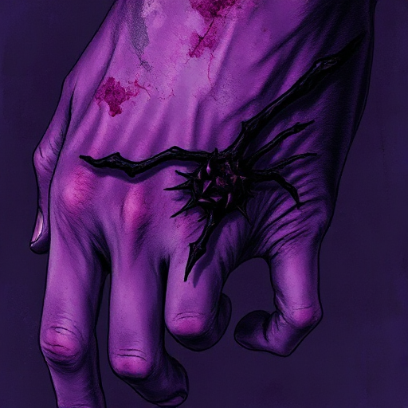

## Die Wunde

Ein vergangenes Trauma oder Erlebnis, das die Figur geformt hat und aus dem ihre gegenwärtige Fehlfunktion, Angst oder Überzeugung stammt.

### Funktion

Gibt der Figur psychologische Tiefe und Glaubwürdigkeit. Erklärt ihr Fehlverhalten, ohne es zu entschuldigen, und macht sie menschlich.

### Anwendung

Was ist das prägende negative Erlebnis in der Vergangenheit meiner Figur? Wie manifestiert es sich in einer ihrer Verhaltensweisen in der ersten Szene?

### Beispiele

- Katniss' Verlust des Vaters (The Hunger Games)
- Batmans Elternmord
- fast jeder traumatisierte Held im psychologischen Drama

### Passt zu

- [Die Lüge der Figur](die-luege-der-figur.md)
- [Rückblende](rueckblende.md)
- [Reise der Heldin](reise-der-heldin.md)

### Quellen

- The Emotional Craft of Fiction, Donald Maass

### Bild

