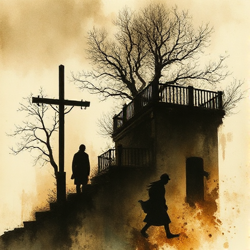

## Doppelfunktion der Szene

Jede Szene sollte mindestens zwei dramatische Funktionen gleichzeitig erfüllen: Plot voranbringen, Charakter enthüllen, Thema stärken oder Welt aufbauen.

### Funktion

Maximiert die Effizienz des Textes und vermeidet Szenen, die nur eine einzige Aufgabe haben und den Lesefluss bremsen.

### Anwendung

Welche zweite Funktion kann ich meiner aktuellen Infoszene geben, damit sie gleichzeitig Charakter enthüllt oder Konflikt erzeugt?

### Beispiele

- Das Familienfrühstück in American Beauty (Familienkonflikt + Charakterisierung + Worldbuilding gleichzeitig)

### Warnung

Eine Szene, die drei oder vier Funktionen hat, verliert an Fokus. Zwei Funktionen sind optimal.

### Passt zu

- [Szenenziel & Hindernisse](szenenziel-hindernisse.md)
- [Leitmotiv](leitmotiv.md)

### Bild

