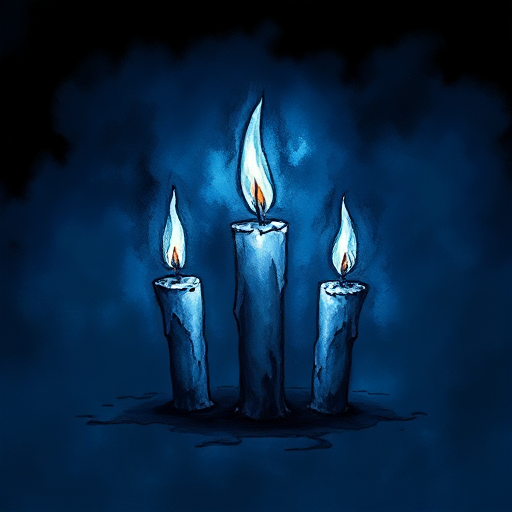

## Dreiecksbeziehung

Drei Figuren, bei denen zwei um die Zuneigung, Loyalität oder Liebe der dritten konkurrieren. So entsteht ein System rivalisierender Ansprüche und Loyalitätskonflikte.

### Funktion

Erzeugt anhaltende Spannung durch ungelöste Entscheidungen, gibt der wählenden Figur eine aktive Wahlsituation und macht Beziehungsdynamiken zum Plotmotor.

### Anwendung

Was macht jede der beiden konkurrierenden Figuren einzigartig attraktiv? Was macht die Entscheidung wirklich unmöglich?

### Beispiele

- Bella – Edward – Jacob (Twilight)
- Katniss – Peeta – Gale (The Hunger Games)
- Aragorn – Arwen – Éowyn (The Lord of the Rings)

### Vorsicht

Ohne echten inneren Konflikt der wählenden Figur wird das Dreieck zur Dauerhinhaltetaktik ohne emotionale Tiefe.

### Passt zu

- [Enemies to Lovers](enemies-to-lovers.md)
- [Slow Burn](slow-burn.md)
- [Der Liebende](der-liebende.md)

### Bild

