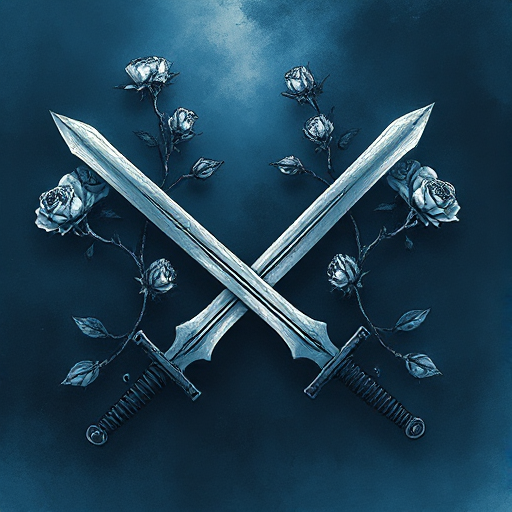

## Enemies to Lovers

Zwei Figuren, die zunächst in Konflikt stehen, entwickeln im Verlauf der Geschichte eine romantische oder tiefe emotionale Verbindung.

### Funktion

Erzeugt anhaltende Spannung, liefert natürliche Konfliktmomente und macht die endgültige Verbindung emotional lohnend.

### Anwendung

Was ist der spezifische Interessenkonflikt, der meine Figuren trennt? Was zwingt sie, diesen zu überwinden?

### Beispiele

- Darcy & Elizabeth (Pride and Prejudice)
- Han Solo & Leia (Star Wars)
- Beatrice & Benedick (Much Ado About Nothing)

### Warnung

Die Feindschaft darf kein reines Missverständnis sein, das ein Gespräch lösen würde. Echter Konflikt ist nötig.

### Passt zu

- [Figur vs. Figur](figur-vs-figur.md)
- [Unterschwelliger Konflikt](unterschwelliger-konflikt.md)
- [Der Liebende](der-liebende.md)
- [Dreiecksbeziehung](dreiecksbeziehung.md)

### Bild

