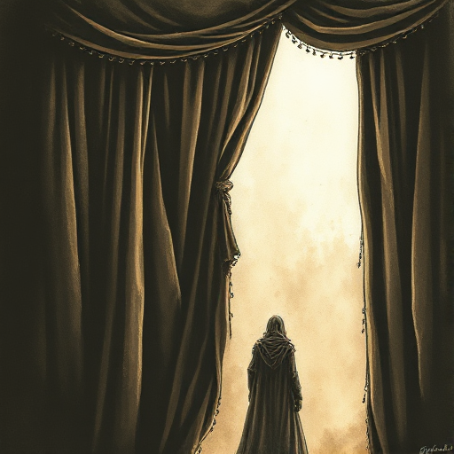

## Enthüllung

Der Moment, in dem eine Figur eine verborgene Wahrheit erkennt und ihre Lage dadurch neu begreift. Oft kennt der Leser die Wahrheit bereits und wartet gespannt auf die Reaktion der Figur.

### Funktion

Verwandelt Wissen in Drama: Die Erkenntnis zwingt die Figur zu einer Reaktion und belohnt aufgebaute Spannung mit einer emotionalen Klimax.

### Anwendung

Wer erfährt die Wahrheit, und weiß der Leser sie schon? Wann, vor wem und auf welchem Weg kommt sie ans Licht, und wie verändert sie das Handeln der Figur?

### Beispiele

- Ödipus erkennt seine Herkunft (König Ödipus, Sophokles)
- Hank findet die Widmung in Walts Buch (Breaking Bad)
- Elizabeth liest Darcys Brief (Stolz und Vorurteil, Austen)

### Warnung

Eine Enthüllung, auf die keine emotionale Reaktion der Figuren folgt, verpufft wirkungslos.

### Passt zu

- [Wendepunkt der Szene](wendepunkt-der-szene.md)
- [Der Twist](der-twist.md)
- [Tschechows Gewehr](tschechows-gewehr.md)
- [Geheime Identität](geheime-identitaet.md)

### Bild

