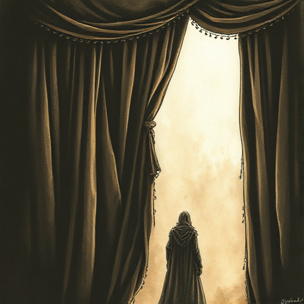

## Enthüllung

Der gezielte Moment, in dem eine zurückgehaltene Information ans Licht kommt und die Bedeutung einer Szene oder Figur neu definiert. Kleiner und lokaler als ein Twist, der die gesamte Geschichte neubewertet.

### Funktion

Erzeugt einen unmittelbaren Wendepunkt innerhalb einer Szene, liefert Belohnung für aufgebaute Spannung und nutzt Figurenreaktionen als emotionale Klimax.

### Anwendung

Was weiß der Leser oder eine Figur in diesem Moment noch nicht? Welche Emotion soll die Enthüllung auslösen: Schock, Erleichterung, Trauer oder Erkenntnis?

### Beispiele

- Snapes wahre Loyalität (Harry Potter)
- das Tagebuch in Rebecca (Du Maurier)
- jede Aufklärungsszene im Krimi

### Vorsicht

Eine Enthüllung, auf die keine emotionale Reaktion der Figuren folgt, verpufft wirkungslos.

### Passt zu

- [Wendepunkt der Szene](wendepunkt-der-szene.md)
- [Der Twist](der-twist.md)
- [Tschechows Gewehr](tschechows-gewehr.md)
- [Geheime Identität](geheime-identitaet.md)

### Bild

