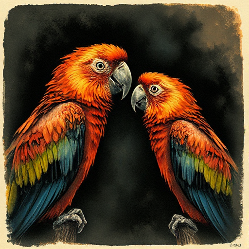

## Exposition im Dialog

Der Versuch, Hintergrundinformation durch unnatürliche Dialoge zu vermitteln, bei denen Figuren Dinge sagen, die beide bereits wissen (»As you know, Bob...«).

### Funktion

Dieser Mechanismus sollte vermieden werden. Er entlarvt den Autor hinter der Fiktion und lässt Figuren wie Informationsbroschüren klingen.

### Anwendung

Wer braucht in dieser Szene wirklich eine Information, und welche Figur weiß sie noch nicht? Nur dann darf erklärt werden.

### Beispiele

- »Wie du weißt, Bruder, ist unser Vater seit zwanzig Jahren König...« – Stilmittel des schlechten Expositions-Dialogs

### Vorsicht

Die gesamte Karte ist eine Warnung.

### Passt zu

- [Fish out of Water](fish-out-of-water.md)
- [In Medias Res](in-medias-res.md)

### Bild

