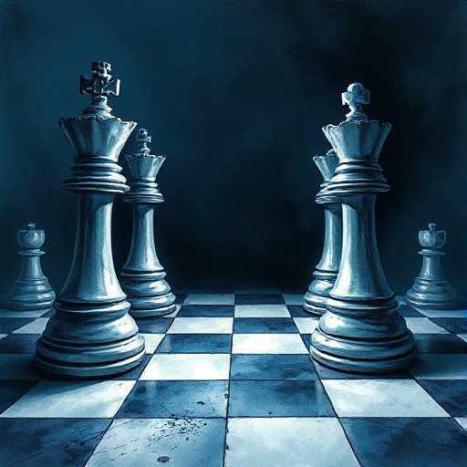

## Figur vs. Figur

Der Konflikt entsteht durch direkte Gegnerschaft zwischen zwei oder mehr Figuren mit unvereinbaren Zielen.

### Funktion

Erzeugt klare Spannung durch persönliche Feindschaft und ermöglicht Konfrontationsszenen, die Charakter enthüllen.

### Anwendung

Was wollen meine Figuren genau, das sich gegenseitig ausschließt? Welche persönliche Geschichte verbindet sie jenseits des aktuellen Konflikts?

### Beispiele

- Sherlock Holmes & Moriarty (Arthur Conan Doyle)
- Salieri & Mozart (Amadeus)
- Jaime & Cersei (Game of Thrones)

### Passt zu

- [Der Gestaltwandler](der-gestaltwandler.md)
- [Enemies to Lovers](enemies-to-lovers.md)

### Bild

