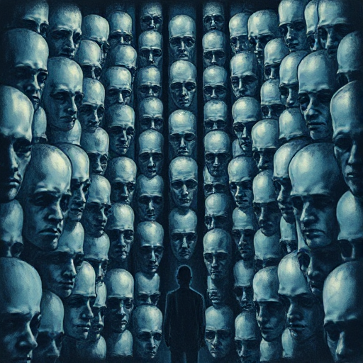

## Figur vs. Gesellschaft

Die Figur steht gegen ein System, eine Norm, eine Institution oder eine kollektive Erwartung, die sie einzwängt oder unterdrückt.

### Funktion

Ermöglicht gesellschaftskritische Themen und gibt dem Konflikt eine politische oder moralische Dimension jenseits des Persönlichen.

### Anwendung

Welche spezifische Regel oder Struktur der Gesellschaft meiner Geschichte macht das Leben meiner Figur unmöglich?

### Beispiele

- Winston Smith (1984)
- Hester Prynne (Der scharlachrote Buchstabe)
- Atticus Finch (Wer die Nachtigall stört)

### Passt zu

- [Der Rebell](der-rebell.md)
- [Moralische Prämisse](moralische-praemisse.md)
- [Der Herrscher](der-herrscher.md)

### Bild

