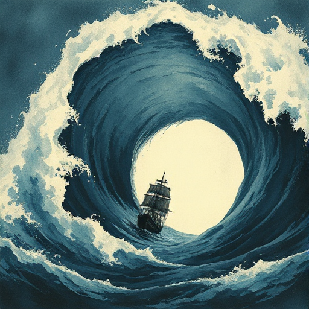

## Figur vs. Natur

Die Figur kämpft gegen natürliche Kräfte: Sturm, Kälte, Wildnis, Tiere, Krankheit oder die eigene Sterblichkeit.

### Funktion

Stellt die menschliche Verletzlichkeit bloß, erzeugt unmittelbaren Überlebenskonflikt und nutzt die Natur oft als Symbol für innere Zustände.

### Anwendung

Wie spiegelt das natürliche Hindernis, gegen das meine Figur kämpft, ihren inneren Zustand wider?

### Beispiele

- Moby Dick (Melville)
- Der alte Mann und das Meer (Hemingway)
- The Revenant
- Life of Pi

### Passt zu

- [Naturspiegelung](naturspiegelung.md)
- [Setting als Charakter](setting-als-charakter.md)

### Bild

