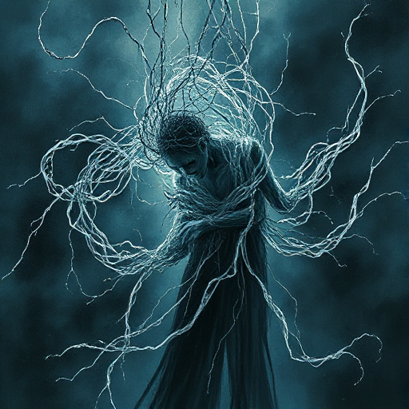

## Figur vs. Schicksal

Die Figur kämpft gegen eine scheinbar vorherbestimmte Zukunft, eine Prophezeiung oder die Unvermeidlichkeit bestimmter Ereignisse an.

### Funktion

Erzeugt tiefe thematische Spannung um freien Willen, um Würde angesichts des Unabänderlichen und um das Verhältnis von Zeit und Ursache.

### Anwendung

Weiß meine Figur von ihrem Schicksal? Wie verändert dieses Wissen ihr Handeln, auch wenn es das Ergebnis nicht ändern kann?

### Beispiele

- Oedipus Rex (Sophocles)
- Macbeth (Shakespeare)
- Arrival (Denis Villeneuve)

### Passt zu

- [Die Prophezeiung](die-prophezeiung.md)
- [Der Auserwählte](der-auserwaehlte.md)

### Bild

