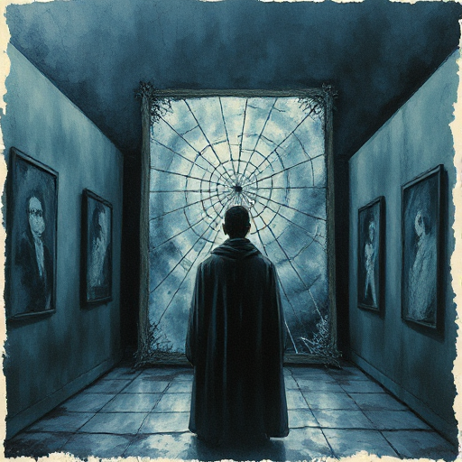

## Figur vs. sich selbst

Der Hauptkonflikt liegt im Innern der Figur: innere Widersprüche, moralische Dilemmata, Sucht, Schuld oder Trauma kämpfen gegeneinander.

### Funktion

Trifft den Leser emotional am tiefsten und ist das Fundament jeder ernsthaften Charakterentwicklung. Fast jede bedeutende Geschichte trägt ihn als zweiten Konflikt in sich.

### Anwendung

Was kämpft in meiner Figur gegeneinander? Welche Entscheidung erzwingt die Geschichte, bei der keine Option wirklich gut ist?

### Beispiele

- Hamlet (Shakespeare)
- Walter White (Breaking Bad)
- Gollum (Der Herr der Ringe)
- Nina (Black Swan)

### Passt zu

- [Tragischer Fehler](tragischer-fehler.md)
- [Die Lüge der Figur](die-luege-der-figur.md)
- [Wunsch vs. Bedürfnis](wunsch-vs-beduerfnis.md)

### Bild

