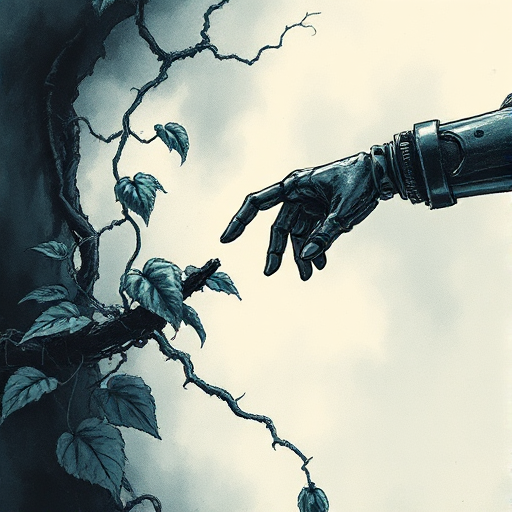

## Figur vs. Technologie

Die Figur steht in Konflikt mit von Menschen geschaffenen Systemen, Maschinen oder technologischen Entwicklungen, die außer Kontrolle geraten sind oder entfremden.

### Funktion

Erkundet Entfremdung, Kontrolle und die Frage, was es bedeutet, Mensch zu sein. Zentral für Science-Fiction und Dystopie.

### Anwendung

Ist die Technologie in meiner Geschichte ein Werkzeug, ein Gegner oder ein Spiegel menschlicher Ambitionen?

### Beispiele

- HAL 9000 (2001: A Space Odyssey)
- Skynet (The Terminator)
- Blade Runner
- Frankenstein (Shelley)

### Passt zu

- [Technologische Paradigmen](technologische-paradigmen.md)
- [Hard Magic System](hard-magic-system.md)
- [Der Schöpfer](der-schoepfer.md)

### Bild

