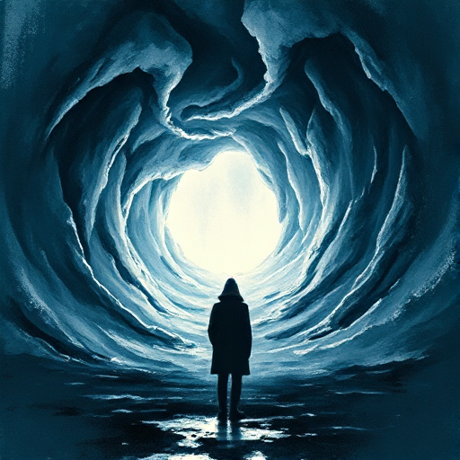

## Figur vs. Übernatürliches

Die Figur trifft auf Kräfte oder Wesen, die jenseits des natürlichen Verständnisses liegen und die normalen Regeln der Welt außer Kraft setzen.

### Funktion

Erkundet existenzielle Angst, religiöse oder spirituelle Themen und das Fremdartige jenseits des Rationalen.

### Anwendung

Was symbolisiert das übernatürliche Element meiner Geschichte? Welche menschliche Angst oder welches Tabu gibt es der Figur preis?

### Beispiele

- Dracula (Stoker)
- The Exorcist
- The Haunting of Hill House (Shirley Jackson)

### Passt zu

- [Soft Magic System](soft-magic-system.md)
- [Setting als Charakter](setting-als-charakter.md)

### Bild

