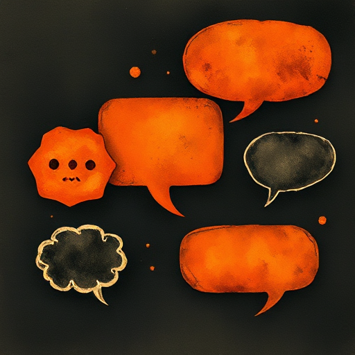

## Figurenstimme

Jede Figur spricht mit einem unverwechselbaren Vokabular, Rhythmus, Dialekt und Register (Sprachebene), die ihre Herkunft, Persönlichkeit und Weltanschauung widerspiegeln.

### Funktion

Macht Figuren ohne Zuschreibung erkennbar und lebendig und verhindert, dass alle Figuren wie der Autor klingen.

### Anwendung

Könntest du den Figurennamen entfernen und den Dialog nur anhand des Sprachstils dem Sprecher zuordnen?

### Beispiele

- Hagrid vs. Dumbledore vs. Voldemort (Harry Potter)
- Gollum (The Lord of the Rings)
- Yoda (Star Wars)

### Vorsicht

Dialekt in Schriftform kann Leser ausschließen oder stereotypisieren. Er sollte deshalb sparsam eingesetzt werden.

### Passt zu

- [Subtext](subtext.md)
- [Tiefer personaler Erzähler (Deep POV)](tiefer-personaler-erzaehler.md)

### Bild

