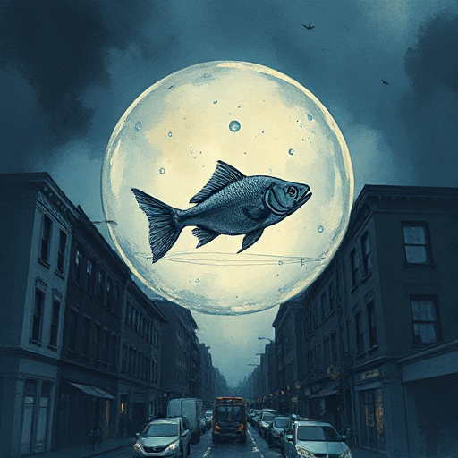

## Fish out of Water

Eine Figur wird in eine fremde Umgebung oder Situation geworfen, in der ihre gewohnten Fähigkeiten und Regeln nicht mehr gelten.

### Funktion

Schafft sofortige Spannung durch Unwissenheit, lässt die Welt beiläufig sichtbar werden und erzeugt Komik oder Tragik durch Missverständnisse.

### Anwendung

Was ist in meiner Welt seltsam oder gefährlich, das einer Figur von außen erklärt werden muss? Wie kann diese Erklärung Konflikt erzeugen statt Info-Dump?

### Beispiele

- Elf (Will Ferrell)
- Thor (Marvel)
- The Devil Wears Prada

### Vorsicht

Dient die Außenseiterfigur nur dazu, sich die Welt erklären zu lassen, ohne eigene Ziele zu verfolgen, bleibt das Potenzial des Tropes ungenutzt.

### Passt zu

- [Kultur & Gesellschaft](kultur-gesellschaft.md)
- [Ich-Erzähler](ich-erzaehler.md)
- [Der Entdecker](der-entdecker.md)

### Bild

