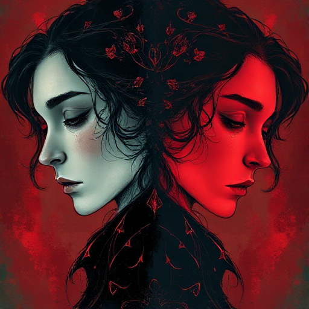

## Gegen-Thema

Eine Figur oder ein Handlungsstrang, der die umgekehrte These zum Hauptthema verkörpert und damit die thematische Frage in Spannung hält.

### Funktion

Verhindert Vereinfachung und einen belehrenden Ton und zeigt, dass die Geschichte die Komplexität ihrer Frage ernst nimmt.

### Anwendung

Wer in meiner Geschichte vertritt am überzeugendsten die entgegengesetzte Position zum Thema? Warum ist er nicht leicht zu widerlegen?

### Beispiele

- Iago als Gegen-Thema zu Vertrauen in Othello
- Salieri als Gegen-Thema zu Mozarts Gnade-durch-Talent in Amadeus

### Passt zu

- [Thematische Frage](thematische-frage.md)
- [Der Schatten](der-schatten.md)

### Bild

