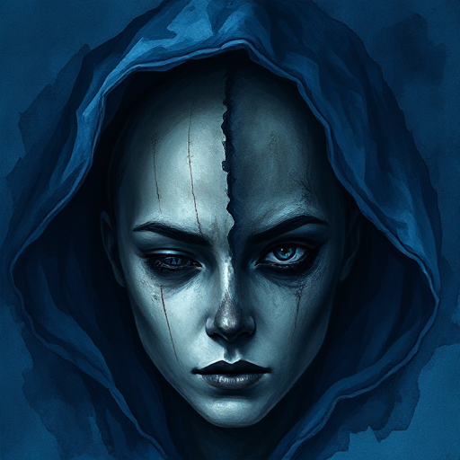

## Geheime Identität

Eine Figur verbirgt bewusst, wer sie wirklich ist – Herkunft, Fähigkeiten oder moralische Ausrichtung. Die geheime Identität ist eine bewusste Entscheidung, keine unklare Loyalität wie beim Gestaltwandler.

### Funktion

Erzeugt Spannung durch Enthüllungsrisiko, ermöglicht Doppelleben-Konflikte und stellt die Frage, welches Ich die wahre Identität ist.

### Anwendung

Was würde meine Figur verlieren, wenn die geheime Identität aufgedeckt würde – und was hindert sie daran, die Wahrheit zu sagen?

### Beispiele

- Batman / Bruce Wayne
- Superman / Clark Kent
- Zorro
- Der Scharlachrote Pimpernel

### Vorsicht

Eine geheime Identität, die nie ernsthaft gefährdet ist, verliert ihre dramatische Funktion.

### Passt zu

- [Der Gestaltwandler](der-gestaltwandler.md)
- [Der Verrat](der-verrat.md)
- [Enthüllung](enthuellung.md)

### Bild

