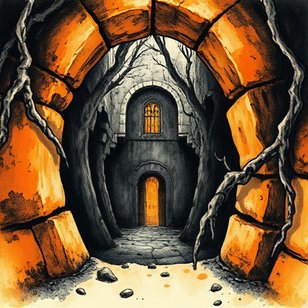

## Ich-Erzähler

Die Geschichte wird in der ersten Person erzählt. Der Erzähler ist Figur in der Geschichte und gibt dem Leser direkten Zugang zu einem einzigen Bewusstsein.

### Funktion

Erzeugt Intimität und Unmittelbarkeit. Schränkt das Wissen auf das ein, was die Figur tatsächlich weiß und erleben kann.

### Anwendung

Was weiß mein Ich-Erzähler nicht? Wie nutze ich diese Lücke für Spannung oder späte Enthüllung?

### Beispiele

- Holden Caulfield (The Catcher in the Rye)
- Scout Finch (To Kill a Mockingbird)
- Ishmael (Moby Dick)

### Vorsicht

Der Ich-Erzähler kann keine Szenen glaubwürdig beschreiben, bei denen er nicht anwesend war.

### Passt zu

- [Unzuverlässiger Erzähler](unzuverlaessiger-erzaehler.md)
- [Tiefer personaler Erzähler](tiefer-personaler-erzaehler.md)

### Bild

