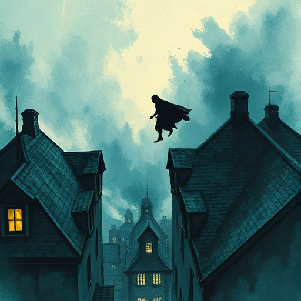

## In Medias Res

Die Geschichte beginnt mitten in der Handlung, ohne lange Exposition. Der Leser wird direkt in einen Moment geworfen und erschließt den Kontext aus der Handlung heraus.

### Funktion

Erzeugt sofortigen Sog, vermeidet langsame Starts und zwingt den Leser durch Neugier in die Geschichte.

### Anwendung

Was ist der spannendste oder aufschlussreichste Moment, mit dem ich meine Geschichte beginnen kann – und wie baue ich die nötige Exposition organisch danach ein?

### Beispiele

- Die Odyssee (Odysseus bereits auf See)
- Casino Royale
- Fight Club (Erzähler bereits mit der Waffe am Kopf)

### Vorsicht

Zu wenig Orientierung zu Beginn kann den Leser verwirren statt fesseln.

### Passt zu

- [Rückblende](rueckblende.md)
- [Rahmenerzählung](rahmenerzaehlung.md)

### Bild

