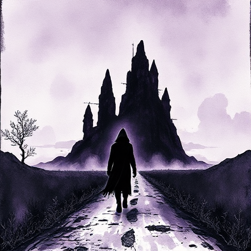

## Innere vs. äußere Reise

Jede Geschichte erzählt gleichzeitig eine äußere Handlung (Plot) und eine innere Reise (Charakterwandlung). Beide Ebenen müssen sich gegenseitig bedingen.

### Funktion

Gibt der Geschichte ihre zweite Dimension. Ohne innere Reise ist es nur Plot, ohne äußere Reise entsteht kein Drama.

### Anwendung

Wie löst die Auflösung des äußeren Konflikts gleichzeitig die innere Wandlung meiner Figur? Oder verunmöglicht sie diese?

### Beispiele

- Frodo vernichtet den Ring (äußere Reise) und verliert seine Unschuld und Heimat für immer (innere Reise, The Lord of the Rings)

### Passt zu

- [Positiver Wandlungsbogen](positiver-wandlungsbogen.md)
- [Scene & Sequel](scene-sequel.md)
- [Story Circle](story-circle.md)

### Bild

