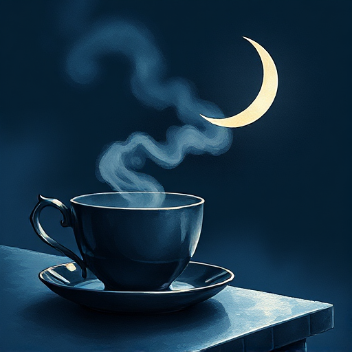

## Kishōtenketsu

Ein ostasiatisches Erzählmuster in vier Akten ohne zentralen Konflikt: Einführung, Entwicklung, Wendung, Auflösung. Spannung entsteht durch die überraschende Verbindung von Elementen.

### Funktion

Erzeugt Bedeutung durch Gegenüberstellung statt durch Konflikt und bietet ein radikales Gegenmodell zum westlichen konflikt-zentrierten Erzählen.

### Anwendung

Welche zwei scheinbar unverbundenen Elemente meiner Geschichte können in einer überraschenden Wendung miteinander in Beziehung gesetzt werden?

### Beispiele

- Spirited Away (Miyazaki)
- viele Manga-Kurzgeschichten
- klassische japanische Lyrik

### Vorsicht

Ohne eine wirklich überraschende Verbindung im dritten Akt wirkt die Struktur orientierungslos.

### Passt zu

- [Der Twist](der-twist.md)
- [Thematische Frage](thematische-frage.md)

### Bild

