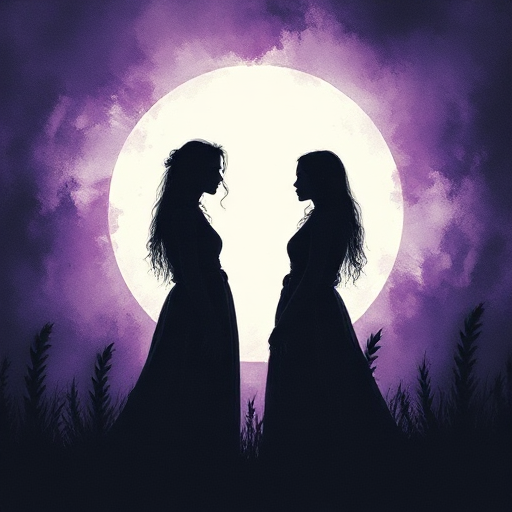

## Kontrastfigur

Eine Figur, die durch Kontrast die Eigenschaften der Hauptfigur hervorhebt. Sie verkörpert den Weg, den der Protagonist nicht gewählt hat oder nicht gehen kann.

### Funktion

Hebt die Eigenschaften der Hauptfigur hervor, vertieft das Thema und schafft Spannung durch Alternative und Spiegelung.

### Anwendung

Welche Entscheidung hat meine Kontrastfigur getroffen, die mein Protagonist nicht treffen konnte – und was sagt dieser Unterschied über das Thema der Geschichte aus?

### Beispiele

- Draco Malfoy als Foil zu Harry Potter
- Laertes als Foil zu Hamlet
- Gaston als Foil zu Beast (Die Schöne und das Biest)

### Passt zu

- [Der Schatten](der-schatten.md)
- [Gegen-Thema](gegen-thema.md)

### Bild

