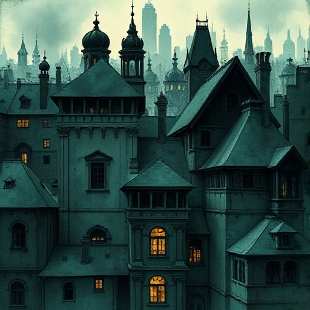

## Kultur & Gesellschaft

Die gesellschaftliche Organisation, Normen, Tabus, Religion, Glaubenssysteme und Sprache einer fiktiven Welt bestimmen, welche Konflikte möglich sind und was die Figuren antreibt.

### Funktion

Verankert Figuren in einer glaubwürdigen sozialen Realität und macht gesellschaftliche Konflikte organisch statt aufgesetzt.

### Anwendung

Was ist in der Gesellschaft meiner Geschichte normal, was tabuisiert? Welche Figur bricht dieses Tabu?

### Beispiele

- Das Kastensystem in Brave New World (Huxley)
- Gilead in The Handmaid's Tale (Atwood)

### Passt zu

- [Figur vs. Gesellschaft](figur-vs-gesellschaft.md)
- [Ökonomie & Macht](oekonomie-macht.md)

### Bild

