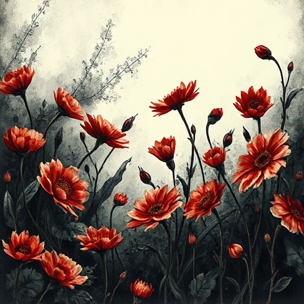

## Leitmotiv

Ein wiederkehrendes bedeutsames Element, etwa ein Bild, ein Satz, ein Symbol oder eine Melodie (Motiv). Durch seine Wiederkehr baut es thematische Tiefe auf und verknüpft die emotionalen Schichten der Geschichte.

### Funktion

Erzeugt ein Gefühl narrativer Kohärenz und emotionaler Resonanz, das weit über den expliziten Inhalt hinausgeht.

### Anwendung

Welches Bild, welcher Satz oder welches Objekt taucht an den wichtigsten emotionalen Momenten meiner Geschichte auf? Verändert sich seine Bedeutung dabei?

### Beispiele

- Der grüne Lichtpunkt (The Great Gatsby)
- Schnee in The Dead (James Joyce)
- die Uhr in vielen Thriller-Narrativen

### Passt zu

- [Symbol](symbol.md)
- [Thematische Frage](thematische-frage.md)

### Bild

