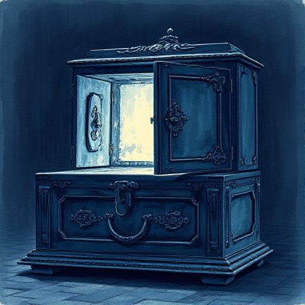

## MacGuffin

Ein Objekt, Ziel oder Geheimnis, das die Figuren begehren und das die Handlung antreibt. Sein tatsächlicher Inhalt ist für die Geschichte irrelevant.

### Funktion

Schafft einen konkreten Fokus für Konflikt und Motivation, ohne die Geschichte auf das Objekt selbst zu beschränken. Die eigentliche Geschichte spielt sich um die Figuren herum ab.

### Anwendung

Was wollen alle Figuren in meiner Geschichte haben oder erreichen? Warum ist es letztlich egal, was es genau ist?

### Beispiele

- Der Aktenkoffer-Inhalt (Pulp Fiction)
- der Ring (The Lord of the Rings)
- das Briefing in North by Northwest (Hitchcock)

### Warnung

Wenn der MacGuffin zu wichtig wird und erklärt werden muss, verliert er seine Funktion.

### Passt zu

- [Tschechows Gewehr](tschechows-gewehr.md)
- [Szenenziel & Hindernisse](szenenziel-hindernisse.md)

### Quellen

- Konzept von Alfred Hitchcock popularisiert

### Bild

